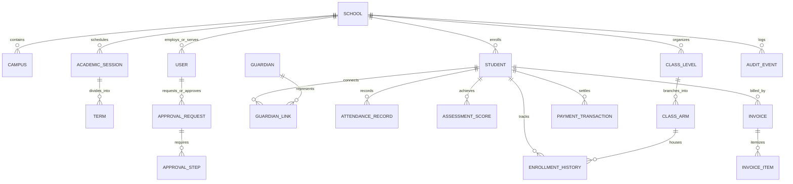

# School Operating System (SchoolOS)
## Database Design & Entity Architecture Specification

> **Document Version**: 1.0  
> **Source Document**: *School Operating System Complete Product Validation, Feature Blueprint, Security Architecture and Development Playbook (28 September 2026)*  
> **Target Database Engine**: PostgreSQL 16+  
> **ORM / Migration Tool**: Prisma / Drizzle ORM  
> **Status**: Comprehensive Baseline (Pending User Sign-Off)

---

## 1. Database Principles & Data Integrity Rules [Playbook p. 7, 18, 44-45]

### 1.1 Non-Destructive Historical Integrity [Playbook p. 18]
- Educational records represent legal, academic, and historical facts. **Destructive updates (`DELETE` or destructive `UPDATE`) are prohibited on historical domain records.**
- Student class changes, withdrawals, promotions, and guardian relationship changes create timestamped transition periods rather than erasing previous realities.
- Soft-deletions use `deleted_at TIMESTAMP WITH TIME ZONE NULL`, with active queries filtered by default.

### 1.2 Strict Multi-Tenancy Scoping [Playbook p. 43]
- Every tenant-scoped table contains `school_id UUID NOT NULL REFERENCES schools(id) ON DELETE RESTRICT`.
- Foreign key constraints prevent accidental cross-tenant record linkages (composite unique constraints include `school_id`).

### 1.3 The Immutable Financial Ledger Rule [Playbook p. 23, 44]
- The financial subsystem is modeled as an **Append-Only Double-Entry Ledger**.
- Student balances are derived dynamically from charges and payments. No table stores an arbitrary, directly editable "balance" column.
- Corrections and refunds create compensating reverse records (`RefundReversal`) tied to a formal Maker-Checker approval.

### 1.4 Append-Only Audit Logging [Playbook p. 45]
- The `audit_events` and `security_events` tables are strictly append-only. Application database users have `INSERT` and `SELECT` privileges only; `UPDATE` and `DELETE` grants are omitted at the database engine level.

---

## 2. Core Domain Entities & Schemas



---

### Domain 1: Multi-Tenancy & School Organization [Playbook p. 11, 16, 44]

#### `schools`
*Represents an independent school tenant (the primary isolation boundary).*
```sql
CREATE TABLE schools (
    id UUID PRIMARY KEY DEFAULT gen_random_uuid(),
    slug VARCHAR(64) UNIQUE NOT NULL,            -- e.g. "kings-college-lagos"
    name VARCHAR(255) NOT NULL,
    official_code VARCHAR(64) UNIQUE,            -- Government registration number
    logo_url TEXT,
    crest_url TEXT,
    currency VARCHAR(3) DEFAULT 'NGN' NOT NULL,  -- ISO-4217 code
    timezone VARCHAR(64) DEFAULT 'Africa/Lagos' NOT NULL,
    status VARCHAR(32) DEFAULT 'ACTIVE' NOT NULL,-- ACTIVE, TRIAL, SUSPENDED, ARCHIVED
    settings JSONB DEFAULT '{}'::jsonb NOT NULL, -- Grading rules, notification prefs, branding
    created_at TIMESTAMP WITH TIME ZONE DEFAULT NOW() NOT NULL,
    updated_at TIMESTAMP WITH TIME ZONE DEFAULT NOW() NOT NULL,
    deleted_at TIMESTAMP WITH TIME ZONE
);
CREATE INDEX idx_schools_status ON schools(status);
```

#### `campuses`
*Supports multi-campus institutions with shared or distinct administration.*
```sql
CREATE TABLE campuses (
    id UUID PRIMARY KEY DEFAULT gen_random_uuid(),
    school_id UUID NOT NULL REFERENCES schools(id) ON DELETE RESTRICT,
    name VARCHAR(128) NOT NULL,                  -- e.g. "Main Campus", "Junior Annex"
    code VARCHAR(32),
    address TEXT NOT NULL,
    city VARCHAR(64) NOT NULL,
    state VARCHAR(64) NOT NULL,
    country VARCHAR(64) DEFAULT 'Nigeria' NOT NULL,
    is_main BOOLEAN DEFAULT FALSE NOT NULL,
    created_at TIMESTAMP WITH TIME ZONE DEFAULT NOW() NOT NULL,
    updated_at TIMESTAMP WITH TIME ZONE DEFAULT NOW() NOT NULL,
    UNIQUE(school_id, name)
);
CREATE INDEX idx_campuses_school_id ON campuses(school_id);
```

---

### Domain 2: Identity, Access Control & Security [Playbook p. 10, 38-39, 44]

#### `users`
*Authoritative user account entity across all stakeholder tiers.*
```sql
CREATE TABLE users (
    id UUID PRIMARY KEY DEFAULT gen_random_uuid(),
    school_id UUID REFERENCES schools(id) ON DELETE RESTRICT, -- NULL only for Platform SuperAdmin
    email VARCHAR(255) NOT NULL,
    phone_number VARCHAR(32),
    password_hash VARCHAR(255) NOT NULL,
    first_name VARCHAR(64) NOT NULL,
    last_name VARCHAR(64) NOT NULL,
    user_type VARCHAR(32) NOT NULL,              -- SUPERADMIN, OWNER, PRINCIPAL, BURSAR, TEACHER, PARENT, STUDENT
    is_active BOOLEAN DEFAULT TRUE NOT NULL,
    is_mfa_enabled BOOLEAN DEFAULT FALSE NOT NULL,
    mfa_secret_encrypted TEXT,
    last_login_at TIMESTAMP WITH TIME ZONE,
    failed_login_attempts INT DEFAULT 0 NOT NULL,
    locked_until TIMESTAMP WITH TIME ZONE,
    created_at TIMESTAMP WITH TIME ZONE DEFAULT NOW() NOT NULL,
    updated_at TIMESTAMP WITH TIME ZONE DEFAULT NOW() NOT NULL,
    UNIQUE(school_id, email)
);
CREATE INDEX idx_users_school_email ON users(school_id, email);
CREATE INDEX idx_users_type ON users(user_type);
```

#### `roles` & `permissions`
*Resource-scoped RBAC engine.*
```sql
CREATE TABLE roles (
    id UUID PRIMARY KEY DEFAULT gen_random_uuid(),
    school_id UUID NOT NULL REFERENCES schools(id) ON DELETE RESTRICT,
    name VARCHAR(64) NOT NULL,                   -- e.g. "Subject Teacher", "Bursar", "Head of Year"
    is_system_role BOOLEAN DEFAULT FALSE NOT NULL,
    created_at TIMESTAMP WITH TIME ZONE DEFAULT NOW() NOT NULL,
    UNIQUE(school_id, name)
);

CREATE TABLE permissions (
    id UUID PRIMARY KEY DEFAULT gen_random_uuid(),
    slug VARCHAR(64) UNIQUE NOT NULL,            -- e.g. "results.enter", "results.lock", "payments.reverse"
    module VARCHAR(32) NOT NULL,                 -- ACADEMICS, FINANCE, SIS, GOVERNANCE
    description TEXT NOT NULL
);

CREATE TABLE role_permissions (
    role_id UUID NOT NULL REFERENCES roles(id) ON DELETE CASCADE,
    permission_id UUID NOT NULL REFERENCES permissions(id) ON DELETE RESTRICT,
    PRIMARY KEY (role_id, permission_id)
);

CREATE TABLE user_roles (
    user_id UUID NOT NULL REFERENCES users(id) ON DELETE CASCADE,
    role_id UUID NOT NULL REFERENCES roles(id) ON DELETE CASCADE,
    assigned_at TIMESTAMP WITH TIME ZONE DEFAULT NOW() NOT NULL,
    PRIMARY KEY (user_id, role_id)
);
```

---

### Domain 3: School Setup & Academic Structure [Playbook p. 11, 16, 44]

#### `academic_sessions` & `terms`
```sql
CREATE TABLE academic_sessions (
    id UUID PRIMARY KEY DEFAULT gen_random_uuid(),
    school_id UUID NOT NULL REFERENCES schools(id) ON DELETE RESTRICT,
    name VARCHAR(32) NOT NULL,                   -- e.g. "2026/2027"
    start_date DATE NOT NULL,
    end_date DATE NOT NULL,
    is_current BOOLEAN DEFAULT FALSE NOT NULL,
    created_at TIMESTAMP WITH TIME ZONE DEFAULT NOW() NOT NULL,
    UNIQUE(school_id, name)
);

CREATE TABLE terms (
    id UUID PRIMARY KEY DEFAULT gen_random_uuid(),
    school_id UUID NOT NULL REFERENCES schools(id) ON DELETE RESTRICT,
    session_id UUID NOT NULL REFERENCES academic_sessions(id) ON DELETE CASCADE,
    name VARCHAR(32) NOT NULL,                   -- "1st Term", "2nd Term", "3rd Term"
    start_date DATE NOT NULL,
    end_date DATE NOT NULL,
    is_current BOOLEAN DEFAULT FALSE NOT NULL,
    is_locked BOOLEAN DEFAULT FALSE NOT NULL,
    UNIQUE(session_id, name)
);
```

#### `class_levels` & `class_arms`
```sql
CREATE TABLE class_levels (
    id UUID PRIMARY KEY DEFAULT gen_random_uuid(),
    school_id UUID NOT NULL REFERENCES schools(id) ON DELETE RESTRICT,
    campus_id UUID NOT NULL REFERENCES campuses(id) ON DELETE RESTRICT,
    name VARCHAR(64) NOT NULL,                   -- e.g. "JSS 1", "Basic 4", "Creche"
    level_order INT NOT NULL,                    -- Hierarchy sorting: 1, 2, 3...
    section VARCHAR(32) NOT NULL,                -- EARLY_YEARS, PRIMARY, JUNIOR_SECONDARY, SENIOR_SECONDARY
    UNIQUE(school_id, campus_id, name)
);

CREATE TABLE class_arms (
    id UUID PRIMARY KEY DEFAULT gen_random_uuid(),
    school_id UUID NOT NULL REFERENCES schools(id) ON DELETE RESTRICT,
    level_id UUID NOT NULL REFERENCES class_levels(id) ON DELETE RESTRICT,
    name VARCHAR(64) NOT NULL,                   -- "Gold", "Diamond", "A", "Blue"
    form_teacher_id UUID REFERENCES users(id) ON DELETE SET NULL,
    capacity INT DEFAULT 35 NOT NULL,
    UNIQUE(level_id, name)
);
```

#### `subjects` & `teacher_allocations`
```sql
CREATE TABLE subjects (
    id UUID PRIMARY KEY DEFAULT gen_random_uuid(),
    school_id UUID NOT NULL REFERENCES schools(id) ON DELETE RESTRICT,
    name VARCHAR(128) NOT NULL,                  -- e.g. "Mathematics", "English Language"
    code VARCHAR(16) NOT NULL,                   -- "MTH", "ENG"
    department VARCHAR(64),                      -- "Science", "Humanities", "Languages"
    is_elective BOOLEAN DEFAULT FALSE NOT NULL,
    UNIQUE(school_id, code)
);

CREATE TABLE teacher_subject_allocations (
    id UUID PRIMARY KEY DEFAULT gen_random_uuid(),
    school_id UUID NOT NULL REFERENCES schools(id) ON DELETE RESTRICT,
    teacher_id UUID NOT NULL REFERENCES users(id) ON DELETE RESTRICT,
    subject_id UUID NOT NULL REFERENCES subjects(id) ON DELETE RESTRICT,
    class_arm_id UUID NOT NULL REFERENCES class_arms(id) ON DELETE RESTRICT,
    term_id UUID NOT NULL REFERENCES terms(id) ON DELETE RESTRICT,
    UNIQUE(subject_id, class_arm_id, term_id)
);
```

---

### Domain 4: Students, Guardians & Enrollment (SIS) [Playbook p. 11-12, 18, 44]

#### `students`
```sql
CREATE TABLE students (
    id UUID PRIMARY KEY DEFAULT gen_random_uuid(),
    school_id UUID NOT NULL REFERENCES schools(id) ON DELETE RESTRICT,
    user_id UUID UNIQUE REFERENCES users(id) ON DELETE SET NULL, -- Student portal login if granted
    admission_number VARCHAR(64) NOT NULL,       -- Stable institutional identifier
    first_name VARCHAR(64) NOT NULL,
    last_name VARCHAR(64) NOT NULL,
    middle_name VARCHAR(64),
    gender VARCHAR(16) NOT NULL,                 -- MALE, FEMALE
    date_of_birth DATE NOT NULL,
    blood_group VARCHAR(8),                      -- A+, O+, etc.
    genotype VARCHAR(8),                         -- AA, AS, SS
    allergies TEXT,
    state_of_origin VARCHAR(64),
    lga VARCHAR(64),
    nationality VARCHAR(64) DEFAULT 'Nigerian' NOT NULL,
    passport_photo_url TEXT,
    status VARCHAR(32) DEFAULT 'ACTIVE' NOT NULL,-- ACTIVE, SUSPENDED, EXPELLED, TRANSFERRED, GRADUATED, WITHDRAWN
    metadata JSONB DEFAULT '{}'::jsonb NOT NULL, -- Dynamic school-defined custom fields
    created_at TIMESTAMP WITH TIME ZONE DEFAULT NOW() NOT NULL,
    updated_at TIMESTAMP WITH TIME ZONE DEFAULT NOW() NOT NULL,
    UNIQUE(school_id, admission_number)
);
CREATE INDEX idx_students_search ON students(school_id, last_name, first_name);
CREATE INDEX idx_students_admission ON students(school_id, admission_number);
```

#### `guardians` & `guardian_student_links`
```sql
CREATE TABLE guardians (
    id UUID PRIMARY KEY DEFAULT gen_random_uuid(),
    school_id UUID NOT NULL REFERENCES schools(id) ON DELETE RESTRICT,
    user_id UUID UNIQUE REFERENCES users(id) ON DELETE CASCADE,
    first_name VARCHAR(64) NOT NULL,
    last_name VARCHAR(64) NOT NULL,
    phone_primary VARCHAR(32) NOT NULL,
    phone_secondary VARCHAR(32),
    email VARCHAR(255) NOT NULL,
    residential_address TEXT,
    occupation VARCHAR(128),
    created_at TIMESTAMP WITH TIME ZONE DEFAULT NOW() NOT NULL
);

CREATE TABLE guardian_student_links (
    id UUID PRIMARY KEY DEFAULT gen_random_uuid(),
    guardian_id UUID NOT NULL REFERENCES guardians(id) ON DELETE CASCADE,
    student_id UUID NOT NULL REFERENCES students(id) ON DELETE CASCADE,
    relationship VARCHAR(32) NOT NULL,           -- FATHER, MOTHER, GUARDIAN, SPONSOR
    is_primary_contact BOOLEAN DEFAULT TRUE NOT NULL,
    is_billing_recipient BOOLEAN DEFAULT TRUE NOT NULL,
    has_custody BOOLEAN DEFAULT TRUE NOT NULL,
    UNIQUE(guardian_id, student_id)
);
```

#### `enrollment_history`
*Non-destructive student enrollment tracking.*
```sql
CREATE TABLE enrollment_history (
    id UUID PRIMARY KEY DEFAULT gen_random_uuid(),
    school_id UUID NOT NULL REFERENCES schools(id) ON DELETE RESTRICT,
    student_id UUID NOT NULL REFERENCES students(id) ON DELETE RESTRICT,
    class_arm_id UUID NOT NULL REFERENCES class_arms(id) ON DELETE RESTRICT,
    term_id UUID NOT NULL REFERENCES terms(id) ON DELETE RESTRICT,
    enrollment_status VARCHAR(32) DEFAULT 'ACTIVE' NOT NULL, -- ACTIVE, PROMOTED, REPEATING, WITHDRAWN
    assigned_at TIMESTAMP WITH TIME ZONE DEFAULT NOW() NOT NULL,
    UNIQUE(student_id, term_id)
);
```

---

### Domain 5: Academics, Timetable & Attendance [Playbook p. 13, 21, 44]

#### `attendance_records`
```sql
CREATE TABLE attendance_records (
    id UUID PRIMARY KEY DEFAULT gen_random_uuid(),
    school_id UUID NOT NULL REFERENCES schools(id) ON DELETE RESTRICT,
    student_id UUID NOT NULL REFERENCES students(id) ON DELETE RESTRICT,
    class_arm_id UUID NOT NULL REFERENCES class_arms(id) ON DELETE RESTRICT,
    date DATE NOT NULL,
    session_period VARCHAR(16) DEFAULT 'MORNING' NOT NULL, -- MORNING, AFTERNOON, SUBJECT
    status VARCHAR(16) NOT NULL,                           -- PRESENT, ABSENT, LATE, EXCUSED, SICKBAY
    recorded_by_id UUID NOT NULL REFERENCES users(id) ON DELETE RESTRICT,
    arrival_time TIME,
    excuse_reason TEXT,
    is_locked BOOLEAN DEFAULT FALSE NOT NULL,
    created_at TIMESTAMP WITH TIME ZONE DEFAULT NOW() NOT NULL,
    UNIQUE(student_id, date, session_period)
);
CREATE INDEX idx_attendance_query ON attendance_records(school_id, class_arm_id, date);
CREATE INDEX idx_attendance_student ON attendance_records(student_id, status);
```

---

### Domain 6: Assessments, Exams, Results & Report Cards [Playbook p. 13, 22, 44]

#### `grade_schemes` & `grade_bands`
```sql
CREATE TABLE grade_schemes (
    id UUID PRIMARY KEY DEFAULT gen_random_uuid(),
    school_id UUID NOT NULL REFERENCES schools(id) ON DELETE RESTRICT,
    name VARCHAR(64) NOT NULL,                   -- e.g. "Senior Secondary WAEC Scale"
    is_default BOOLEAN DEFAULT FALSE NOT NULL,
    created_at TIMESTAMP WITH TIME ZONE DEFAULT NOW() NOT NULL
);

CREATE TABLE grade_bands (
    id UUID PRIMARY KEY DEFAULT gen_random_uuid(),
    grade_scheme_id UUID NOT NULL REFERENCES grade_schemes(id) ON DELETE CASCADE,
    grade_letter VARCHAR(4) NOT NULL,            -- "A", "B", "C", "F"
    min_score NUMERIC(5,2) NOT NULL,             -- 75.00
    max_score NUMERIC(5,2) NOT NULL,             -- 100.00
    gpa_point NUMERIC(3,2) DEFAULT 0.00 NOT NULL,
    remark VARCHAR(64) NOT NULL                  -- "Excellent", "Very Good", "Credit"
);
```

#### `assessment_scores`
```sql
CREATE TABLE assessment_scores (
    id UUID PRIMARY KEY DEFAULT gen_random_uuid(),
    school_id UUID NOT NULL REFERENCES schools(id) ON DELETE RESTRICT,
    student_id UUID NOT NULL REFERENCES students(id) ON DELETE RESTRICT,
    subject_id UUID NOT NULL REFERENCES subjects(id) ON DELETE RESTRICT,
    class_arm_id UUID NOT NULL REFERENCES class_arms(id) ON DELETE RESTRICT,
    term_id UUID NOT NULL REFERENCES terms(id) ON DELETE RESTRICT,
    ca1_score NUMERIC(5,2),                      -- Max 10 or 20 per school config
    ca2_score NUMERIC(5,2),
    midterm_score NUMERIC(5,2),
    exam_score NUMERIC(5,2),                     -- Max 60
    total_score NUMERIC(5,2) GENERATED ALWAYS AS (
        COALESCE(ca1_score, 0) + COALESCE(ca2_score, 0) + COALESCE(midterm_score, 0) + COALESCE(exam_score, 0)
    ) STORED,
    grade_letter VARCHAR(4),
    status VARCHAR(32) DEFAULT 'DRAFT' NOT NULL, -- DRAFT, SUBMITTED, MODERATED, APPROVED, LOCKED
    entered_by_id UUID NOT NULL REFERENCES users(id) ON DELETE RESTRICT,
    moderated_by_id UUID REFERENCES users(id) ON DELETE RESTRICT,
    locked_at TIMESTAMP WITH TIME ZONE,
    updated_at TIMESTAMP WITH TIME ZONE DEFAULT NOW() NOT NULL,
    UNIQUE(student_id, subject_id, term_id)
);
CREATE INDEX idx_scores_lookup ON assessment_scores(school_id, class_arm_id, subject_id, term_id);
```

#### `report_cards`
```sql
CREATE TABLE report_cards (
    id UUID PRIMARY KEY DEFAULT gen_random_uuid(),
    school_id UUID NOT NULL REFERENCES schools(id) ON DELETE RESTRICT,
    student_id UUID NOT NULL REFERENCES students(id) ON DELETE RESTRICT,
    term_id UUID NOT NULL REFERENCES terms(id) ON DELETE RESTRICT,
    class_arm_id UUID NOT NULL REFERENCES class_arms(id) ON DELETE RESTRICT,
    cumulative_average NUMERIC(5,2) NOT NULL,
    class_average NUMERIC(5,2),
    position INT,                                -- Optional rank
    teacher_comment TEXT,
    principal_comment TEXT,
    affective_ratings JSONB DEFAULT '{}'::jsonb, -- Punctuality, neatness, etc.
    psychomotor_ratings JSONB DEFAULT '{}'::jsonb,
    verification_hash VARCHAR(64) UNIQUE NOT NULL,-- Cryptographic QR validation hash
    pdf_storage_url TEXT,
    is_published BOOLEAN DEFAULT FALSE NOT NULL,
    published_at TIMESTAMP WITH TIME ZONE,
    UNIQUE(student_id, term_id)
);
```

---

### Domain 7: Fees, Invoicing & Financial Ledger [Playbook p. 13, 23-24, 44]

#### `fee_structures` & `invoices`
```sql
CREATE TABLE fee_structures (
    id UUID PRIMARY KEY DEFAULT gen_random_uuid(),
    school_id UUID NOT NULL REFERENCES schools(id) ON DELETE RESTRICT,
    term_id UUID NOT NULL REFERENCES terms(id) ON DELETE RESTRICT,
    class_level_id UUID NOT NULL REFERENCES class_levels(id) ON DELETE RESTRICT,
    name VARCHAR(128) NOT NULL,                  -- e.g. "JSS 1 Resumption Tuition 2026"
    amount NUMERIC(12,2) NOT NULL,
    fee_category VARCHAR(32) NOT NULL,           -- TUITION, BOARDING, TRANSPORT, PTA, UNIFORM
    is_mandatory BOOLEAN DEFAULT TRUE NOT NULL,
    created_at TIMESTAMP WITH TIME ZONE DEFAULT NOW() NOT NULL
);

CREATE TABLE invoices (
    id UUID PRIMARY KEY DEFAULT gen_random_uuid(),
    school_id UUID NOT NULL REFERENCES schools(id) ON DELETE RESTRICT,
    invoice_number VARCHAR(64) UNIQUE NOT NULL,  -- e.g. "INV-2026-00452"
    student_id UUID NOT NULL REFERENCES students(id) ON DELETE RESTRICT,
    term_id UUID NOT NULL REFERENCES terms(id) ON DELETE RESTRICT,
    subtotal_amount NUMERIC(12,2) NOT NULL,
    discount_amount NUMERIC(12,2) DEFAULT 0.00 NOT NULL,
    total_amount NUMERIC(12,2) NOT NULL,
    amount_paid NUMERIC(12,2) DEFAULT 0.00 NOT NULL, -- Computed dynamically in ledger; maintained for read speed
    status VARCHAR(32) DEFAULT 'UNPAID' NOT NULL,-- UNPAID, PARTIAL, PAID, CANCELLED
    due_date DATE NOT NULL,
    created_at TIMESTAMP WITH TIME ZONE DEFAULT NOW() NOT NULL
);

CREATE TABLE invoice_items (
    id UUID PRIMARY KEY DEFAULT gen_random_uuid(),
    invoice_id UUID NOT NULL REFERENCES invoices(id) ON DELETE CASCADE,
    fee_structure_id UUID REFERENCES fee_structures(id) ON DELETE RESTRICT,
    description VARCHAR(255) NOT NULL,
    amount NUMERIC(12,2) NOT NULL
);
```

#### `payment_transactions` & `refund_reversals`
*Authoritative append-only financial records.*
```sql
CREATE TABLE payment_transactions (
    id UUID PRIMARY KEY DEFAULT gen_random_uuid(),
    school_id UUID NOT NULL REFERENCES schools(id) ON DELETE RESTRICT,
    receipt_number VARCHAR(64) UNIQUE NOT NULL,  -- e.g. "REC-2026-98124"
    invoice_id UUID NOT NULL REFERENCES invoices(id) ON DELETE RESTRICT,
    student_id UUID NOT NULL REFERENCES students(id) ON DELETE RESTRICT,
    amount NUMERIC(12,2) NOT NULL,
    payment_method VARCHAR(32) NOT NULL,         -- PAYSTACK, FLUTTERWAVE, BANK_TRANSFER, POS, CASH
    provider_reference VARCHAR(128) UNIQUE,      -- Paystack trxn reference (idempotency anchor)
    payer_name VARCHAR(128) NOT NULL,
    payer_phone VARCHAR(32),
    settled_at TIMESTAMP WITH TIME ZONE DEFAULT NOW() NOT NULL,
    recorded_by_id UUID NOT NULL REFERENCES users(id) ON DELETE RESTRICT,
    status VARCHAR(32) DEFAULT 'SETTLED' NOT NULL-- SETTLED, PENDING, FAILED, REVERSED
);
CREATE INDEX idx_payment_student ON payment_transactions(school_id, student_id);

CREATE TABLE refund_reversals (
    id UUID PRIMARY KEY DEFAULT gen_random_uuid(),
    school_id UUID NOT NULL REFERENCES schools(id) ON DELETE RESTRICT,
    original_transaction_id UUID NOT NULL REFERENCES payment_transactions(id) ON DELETE RESTRICT,
    amount NUMERIC(12,2) NOT NULL,
    reason TEXT NOT NULL,
    approval_request_id UUID NOT NULL,           -- Bound to Maker-Checker approval
    executed_by_id UUID NOT NULL REFERENCES users(id) ON DELETE RESTRICT,
    executed_at TIMESTAMP WITH TIME ZONE DEFAULT NOW() NOT NULL
);
```

---

### Domain 8: Governance & Maker-Checker Approvals [Playbook p. 23, 36-37, 44, 67]

#### `approval_requests` & `approval_steps`
```sql
CREATE TABLE approval_requests (
    id UUID PRIMARY KEY DEFAULT gen_random_uuid(),
    school_id UUID NOT NULL REFERENCES schools(id) ON DELETE RESTRICT,
    action_type VARCHAR(64) NOT NULL,            -- RESULT_CORRECTION, PAYMENT_REVERSAL, ROLE_ELEVATION, DATA_EXPORT
    approval_level INT DEFAULT 2 NOT NULL,       -- 1 = Single, 2 = Dual Control, 3 = Quorum
    requester_id UUID NOT NULL REFERENCES users(id) ON DELETE RESTRICT,
    target_resource_type VARCHAR(64) NOT NULL,   -- e.g. "assessment_scores", "payment_transactions"
    target_resource_id UUID NOT NULL,
    reason TEXT NOT NULL,
    payload_before JSONB NOT NULL,               -- Snapshot of record state prior to change
    payload_proposed JSONB NOT NULL,             -- Requested changes
    status VARCHAR(32) DEFAULT 'PENDING_APPROVAL' NOT NULL, -- PENDING_APPROVAL, APPROVED, REJECTED, EXPIRED, EXECUTED
    expires_at TIMESTAMP WITH TIME ZONE DEFAULT (NOW() + INTERVAL '72 hours') NOT NULL,
    created_at TIMESTAMP WITH TIME ZONE DEFAULT NOW() NOT NULL,
    executed_at TIMESTAMP WITH TIME ZONE
);

CREATE TABLE approval_steps (
    id UUID PRIMARY KEY DEFAULT gen_random_uuid(),
    request_id UUID NOT NULL REFERENCES approval_requests(id) ON DELETE CASCADE,
    step_number INT NOT NULL,                    -- Step 1 (Academic/Finance Lead), Step 2 (Principal/Owner)
    required_role VARCHAR(64) NOT NULL,
    approver_id UUID REFERENCES users(id) ON DELETE RESTRICT,
    decision VARCHAR(16),                        -- APPROVED, REJECTED
    comments TEXT,
    decided_at TIMESTAMP WITH TIME ZONE,
    UNIQUE(request_id, step_number)
);
```

---

### Domain 9: Immutable Audit Logging [Playbook p. 38, 45]

#### `audit_events`
```sql
CREATE TABLE audit_events (
    id UUID PRIMARY KEY DEFAULT gen_random_uuid(),
    school_id UUID NOT NULL REFERENCES schools(id) ON DELETE RESTRICT,
    actor_id UUID REFERENCES users(id) ON DELETE SET NULL,
    actor_ip VARCHAR(45) NOT NULL,
    actor_user_agent TEXT,
    action VARCHAR(64) NOT NULL,                 -- e.g. "AUTH_LOGIN", "SCORE_EDIT_REQUEST", "PAYMENT_RECORDED"
    resource_type VARCHAR(64) NOT NULL,          -- e.g. "student", "report_card", "invoice"
    resource_id UUID,
    before_state JSONB,
    after_state JSONB,
    created_at TIMESTAMP WITH TIME ZONE DEFAULT NOW() NOT NULL
);
-- Strictly append-only: No index on updated_at because records are never updated
CREATE INDEX idx_audit_school_time ON audit_events(school_id, created_at DESC);
CREATE INDEX idx_audit_actor ON audit_events(school_id, actor_id);
```

---

## 3. Data Retention, Archival & NDPA Compliance [Playbook p. 40]

1. **Academic Transcript Retention**: Student academic assessment scores and official term report cards must be retained indefinitely (minimum 25 years) per statutory education records compliance.
2. **Financial Records**: All invoices, payment transactions, receipts, and refund approvals are retained for a minimum of 7 years in compliance with financial auditing standards.
3. **NDPA 2023 Right to be Forgotten**:
   - When a data erasure request is authorized, non-academic personal data (parent phone, residential address, emergency contact, passport photograph) is sanitized/anonymized.
   - The student's academic history remains preserved under a pseudonymized identifier to maintain institutional graduation roll integrity without violating data privacy statutes.
